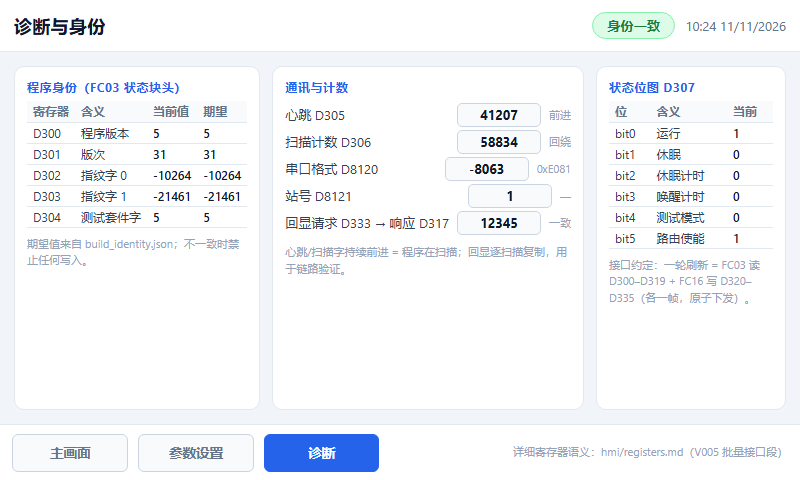

# S3 诊断与身份

## 组件清单

身份表（D300–D304 当前值/期望值）· 通讯与计数卡（D305/D306/D8120/D8121/D333→D317）·
状态位图表（D307 bit0–bit5）· 身份一致 chip · 底栏导航。

## 变量绑定（对应 params.md 行）

| 显示 | 地址 | 说明 |
|---|---|---|
| 程序版本/版次/指纹/套件字 | D300–D304 | 期望值来自 `../../build_identity.json`；不一致 → 全屏黄条+禁写 |
| 心跳 | D305 | 持续前进 = 程序扫描中 |
| 扫描计数 | D306 | signed 回绕 |
| 串口格式/站号 | D8120/D8121 | 检查点记录（-8063=0xE081 / 1），不逐步判读 |
| 回显请求→响应 | D333→D317 | 链路验证；逐执行扫描复制 |
| 状态位图 | D307 | bit0 运行 / bit1 休眠 / bit2 休眠计时 / bit3 唤醒计时 / bit4 测试 / bit5 使能 |

## 交互流程

1. 只读页；无写操作。
2. 进入时读状态块并比对身份；比对失败 → 黄条 + 引导到人工核验流程（不自动重试写入）。
3. 回显测试：写 D333（需工程师权限）→ 下一刷新比对 D317。

## 场景变体

- 身份不一致态：全屏黄条（未出图，组态评审时补）。
