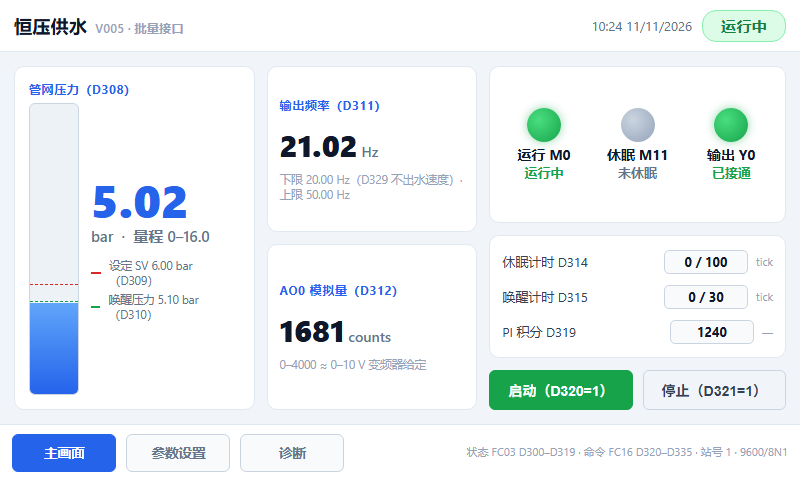
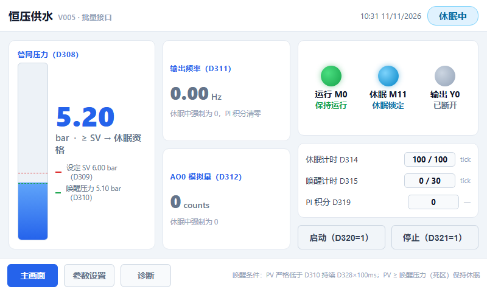

# S1 主画面 — 运行态 / 休眠态

## 组件清单

顶栏（标题+版本、时钟、系统态 chip）· 压力卡（压力条 0–16.0 bar + SV/唤醒压力刻度）·
频率卡（D311）· AO0 卡（D312）· 状态灯排（M0/M11/Y0）· 计时卡（D314/D315/D319）·
启停按钮 · 底栏导航。

## 变量绑定（对应 params.md 行）

| 显示 | 地址 | 读写 | 说明 |
|---|---|---|---|
| 管网压力 | D308 | RO | 0.1 bar；压力条按 /1600 比例；SV 刻线=D309，唤醒刻线=D310 |
| 系统态 chip | D307 bit0/bit1 | RO | 运行中 / 休眠中（休眠优先显示） |
| 输出频率 | D311 | RO | 0.01 Hz；休眠恒 0 |
| AO0 | D312 | RO | raw counts；≈频率×4/5 |
| 运行/休眠/Y0 灯 | D307 + Y0(coil 0x3300) | RO | Y0=M0∧D323∧D154>0 |
| 休眠/唤醒计时 | D314/D315 | RO | 饱和显示，"当前/上限" |
| PI 积分 | D319 | RO | 休眠/停止时为 0 |
| 启动/停止按钮 | D320/D321 | RW | FC16 命令块；停止优先 |

## 交互流程

1. 上电默认 S1；身份未核验前只读（见 PRD 身份门）。
2. 启动：确认弹窗 → FC16 帧内 D320=1（同帧其余命令字保持当前值）→ 界面帧间隙锁写。
3. 停止：永可达，确认后 D321=1；同时按下的启动请求由程序按停止优先裁决。
4. 运行↔休眠为自动状态切换（按 D307），不提供手动休眠/唤醒入口。

## 场景变体

- `overview.png` 运行态：PV 5.02 bar < SV，频率 21.02 Hz，Y0 接通。
- `overview-sleep.png` 休眠态：PV 5.20 bar ≥ SV 满 D327 后休眠锁定；频率/AO=0，Y0 断开，D314=100/100。
- 重启抑制（M12）：D322 非 0/1 时顶栏黄 chip，启动禁用；未单独出图（待组态评审决定是否需要截图）。
