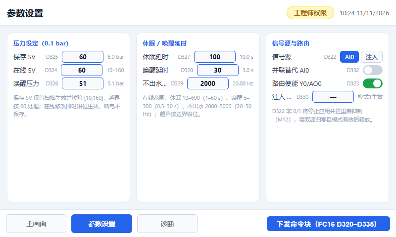

# S2 参数设置（工程师）

## 组件清单

顶栏（工程师权限 chip）· 压力设定卡（D325/D324/D326）· 休眠/唤醒延时卡（D327/D328/D329）·
信号源与路由卡（D322 段选、D332/D323 开关、D330 注入）· 下发命令块按钮 · 底栏导航。

## 变量绑定（对应 params.md 行）

| 参数 | 地址 | 范围 | 写入语义 |
|---|---|---|---|
| 保存 SV | D325 | 10–160（0.1 bar） | 首扫描生效并校验，越界按 60 |
| 在线 SV | D324 | 10–160 | 即时钳位生效，不入保存区 |
| 唤醒压力 | D326 | 0–160 | 首扫默认 = floor(保存SV×85/100)，之后仅外部写 |
| 休眠延时 | D327 | 10–600 tick（1–60 s） | 在线钳位 |
| 唤醒延时 | D328 | 5–300 tick（0.5–30 s） | 在线钳位 |
| 不出水速度 | D329 | 2000–5000（0.01 Hz） | 在线钳位 |
| 信号源 | D322 | 0=AI0 / 1=注入 D330 | 非 0/1 → 停机+重启抑制 |
| 并联替代 AI0 | D331/D332 | D332=1 生效 | D332=0 保持真实 AI0 |
| 路由使能 | D323 | 0/1 | Y0/AO0 输出门 |
| 注入 PV | D330 | 0–4000 raw | D322=1 时生效 |

## 交互流程

1. 工程师密码门（组态实现；原型示意 chip）。
2. 修改任一参数 → 前端按上表范围预校验 → 确认弹窗 → 与其余命令字同帧 FC16 下发。
3. 「下发命令块」按钮 = 手动整帧下发（调试用）；正常运行逐项即改即发。
4. D322 切换注入模式时弹警告（无效值停机语义）。

## 场景变体

- 无独立变体；权限不足时整页只读（chip 换灰）。
