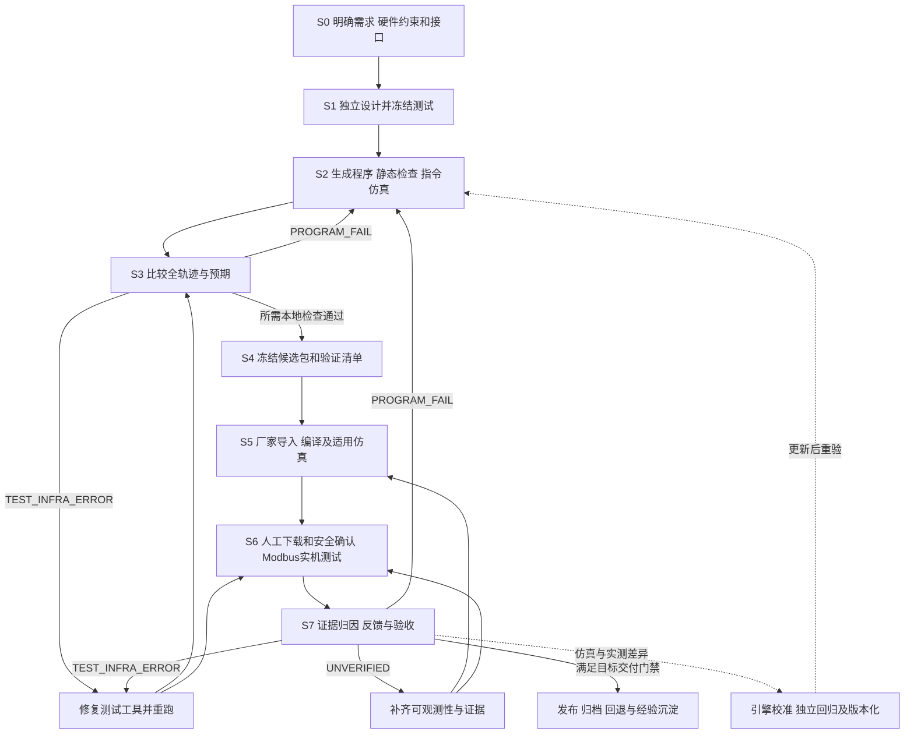

> 2026-10-22用户修订优先：[当前技能](../skills/plc-program-development/SKILL.md)。新项目初版只MD，复核4独立Agent，客户目录project/或明确指定目录，最终交付目录+ZIP；以下未实施架构仍为规划。

# PLCWeave：项目定位、完整工作流与工具链蓝图

> 2026-10-24 用户补充：[第一阶段流程与交付规范](PART-ONE.md)、[第二阶段人工下载与HIL闭环](PART-TWO.md)。第一部分从需求、资源分配、设计和用例进入编程，语法检查与回归后交付四类成果，包含测试版与正式版两份指令表；用户只修改需求，AI联动修订后续成果并重新验证。第二部分由用户在厂家软件中编译下载测试版，提供串口及连接条件后，AI用脚本采集实际PLC数据并与冻结预期比较；程序问题修复后经用户重新编译下载再回归，直至规定测试全部通过或如实报告阻塞。2026-10-26已有受支持FX子集双版生成和L01S稳态采样编排入口，实际使用见[两阶段工作流](../skills/plc-program-development/references/two-phase-workflow.md)；自然语言设计仍由Agent完成，跨品牌适配和实机验证不从工具实现中推断。下文S0–S7是工程步骤和验证方法，不取消第一阶段独立交付。

> 2026-10-22 实施更新：下文保留最初蓝图。当前已完成首个本地执行切片和 PlatformIO 仿真编排；实际边界见 README、ROADMAP 和 RUNTIME-CHANGES。原文“仅骨架/未引入”是建仓时状态，不代表整合后的现状。

日期：2026-10-22。状态：PLCWeave（控程工坊）名称与本地建仓已获用户确认；本机注册号040，目录103-plcweave。本文整理PLC-TDD V2.0的S0–S7，描述目标结构并区分已有资产与待实现模块；项目骨架已建立，尚未整合执行模块或公开远程仓库。

## 1. 名称与定位

**推荐英文名：PLCWeave。推荐中文展示名：控程工坊。推荐仓库名：`plcweave`。**

Weave 指把需求、程序、测试和真实运行证据编织在一起。PLC 直接说明应用领域；名字不限定单一品牌、梯形图语言或某一家AI模型，能覆盖后续指令表、ST及多品牌适配。

一句话定位：**测试驱动的开源 PLC 开发工具链，连接 AI 编程、本地仿真、厂家验证与硬件在环测试。**

英文介绍建议：**An open-source, test-driven PLC engineering toolkit connecting AI-assisted programming, simulation, vendor validation, and hardware-in-the-loop testing.**

简短标语：**从需求到程序，让每次验证都有证据。**

2026-10-22做了公开网页名称初筛，未发现明显同名PLC软件，但这不代表商标、域名、GitHub组织或包名已确认可用。`PLCForge`已存在同领域产品，不建议使用：[PLCforge](https://www.plcforge.ai/product)、[PLCForge Simulator](https://plcforge.net/)。备选名可考虑 `LadderLoop`（突出闭环但偏梯形图）或 `PLCTraceLab`（突出验证但弱化需求/生成），本轮未核定其可注册性。

项目最有价值的产物不仅是程序文件，还包括：可检验的需求、独立测试、确定性执行、分层验证记录、可复用模块和问题经验。它应提供可单独调用的CLI/API，并允许AI Agent编排这些工具；AI负责理解、生成和分析，测试器负责按冻结标准作判定。

## 2. 三条相互连接的反馈路径



**程序内循环**：S2→S3，自动生成、执行、定位差异、修复。

**真实设备外循环**：S4→S5→S6→S7，人工下载与现场确认，确定性脚本采集和断言，真实程序缺陷回S2。

**工具改进路径**：把厂家/硬件对照差异加入黄金测试，独立修正引擎。不能同时改程序、测试预期和仿真器来追求“全绿”；这属于工具与知识更新，不代表AI基础模型权重训练。

## 3. 每阶段工作、工具、产物与门禁

### S0：需求分析、硬件约束及接口冻结

输入：客户工艺说明、完整PLC机型/固件、现有工程、端子图、传感器/执行器手册、I/O点表、HMI需求、已知现场问题。

工作：

1. 区分新开发、修改、排错和仿真演示；登记任务与资源归属。
2. 给功能分配需求ID，明确模式、启停、状态转移、时序、报警、复位和断电恢复。
3. 查明机型真实I/O、电气类型、脉冲能力、模拟量、保持区、专用指令/寄存器、通信方式；记录手册版本和依据。
4. 分配I/O与寄存器，写明类型、位宽、单位、倍率、默认值、读写权限、保持属性和连续占用范围。
5. 定义各故障的预期响应。断线时全速、保持或停止必须由项目需求确定，不能从某个供水案例泛化。

工具链：AI Agent + Markdown（需求和测试唯一作者源）；文档提取器（现有markitdown作为可选工具）；JSON Schema及规则检查；Git；机型/指令事实库；经验检索接口。

产物：`requirements.md`、`test_cases.md`及其中的I/O、寄存器、故障、状态机和待确认说明；初版不另生成JSON/YAML副本。

门禁：规格可测，影响设计或安全的关键歧义已解决；未知能力明确标记。Hindsight/ZERO是本公司可选集成，开源用户不应被迫安装它们。

### S1：先定义正确结果，再编程

工作：依据S0独立编写测试规范；覆盖正常流程、边界、异常、恢复、扫描瞬态、互锁、计时、数值溢出、参数保持与通信异常。每例写清初态、输入序列、观察对象、时间窗/容差、复位/清理和MUST/SHOULD优先级。

工具链：独立的测试设计Agent/角色；测试Schema检查器；用例版本/哈希工具；pytest作为测试框架；Markdown承载用例，执行时内存解析。

产物：规范化测试集、全程不变量、需求覆盖表、客户可读测试文档。新项目只维护test_cases.md；历史JSON/YAML仅作为兼容资料，不为新项目另建同义作者源。

门禁：测试先冻结，S2实现方不得自行改预期；规格或用例确有错误时走单独修订并记录原因。不要通过修改断言迁就引擎的现有输出。dev/holdout须区分；已公开、已反复调试的用例不再声称是独立隐藏测试。

### S2：程序生成、静态检查与真实指令执行

工作：AI按机型与能力表编写源程序；解析到带源位置的指令表示；检查指令签名、操作数类型、地址范围、双字/块占用、堆栈、END、重复输出、专用区；编译到本地执行计划；按扫描模型运行，输出设备轨迹与诊断。

工具链：Agent接口；FX `.fxil`与CSV解析器；gxworks-agent来源的指令事实JSON；目标机型profile；扩展的gxwlib Rust执行核及Python绑定；Python编排和pytest/Rust微测试；现有CSV生成/格式校验脚本。

产物：程序源、规范化指令表示、静态诊断、source map、仿真轨迹、引擎版本/能力清单。

门禁：未实现/不适配目标的指令返回UNSUPPORTED，不能变成NOP；只识别助记符不代表支持执行。已实现但尚未厂家对照的能力可如实做本地测试，记录验证等级，不能称GX/硬件通过。CSV格式PASS不代替指令编译或逻辑验证。

当前102执行核是这个阶段的一部分，首个切片已含MOV/ADD；不能因此称为完整FX3U仿真器。品牌事实库也不能充当执行引擎。

### S3：独立比较全部必要行为

工作：只读加载S1，比较S2轨迹的每次有关状态、时间窗和不变量，输出最早失败点、预期/实际、关联网络/源行；防止只检查终值而漏掉一个扫描的互锁违规。

工具链：共用Test Engine与比较器；pytest runner；JSON/CSV/JSONL轨迹；diff/报告生成；受限迭代控制器。

产物：`validation.json`、差异报告、需求覆盖、失败复现输入、迭代记录。

门禁：MUST用例全部通过；数据不全不能判PASS；测试工具错误不能伪装成程序错误。连续三轮无改善、反复回归或能力缺口时停止自动修改并出诊断；只把PROGRAM_FAIL交回程序生成方。超时/取消时保存断点并清理任务资源。

### S4：生成并冻结候选包

工作：从唯一源生成厂家导入件和注释、测试文档、接线/寄存器表、指令详解、验证清单；绑定需求/测试/程序/工具版本及哈希，清楚标识候选尚待哪些验证。

工具链：`gen_fx_csv.py`、`gen_il_md.py`及品牌exporter；CSV方言适配；文档模板和HTML→PDF；Git/tag；manifest及打包校验器。

产物：`candidate/<release_id>/`，含厂家导入文件、源与用例、寄存器表、现有验证结果、哈希manifest、版本变化。

门禁：包内版本一致；程序/注释/PDF来自同版本；厂家CSV方言与引擎输入方言明确区分并可追溯转换。`candidate/`为内部候选，客户最终`delivery/`在实际交付时生成，避免把本地测试候选误称最终交付。

### S5：厂家软件编译与适用仿真

工作：在正确CPU工程中导入本版CSV；执行厂家转换、程序检查；提取真实错误；运行其支持范围内的测试，保存工程身份、截图/日志和轨迹。厂家编译可在开发早期提前跑，以便快速拒绝非法程序。

工具链：用户自行安装授权的GX Works2 + GX Simulator2；Windows适配器；现有101项目的pywinauto/GUI探索资产；诊断解析器；人工操作清单。gxworks-agent可选复用，其实际API/版本与许可边界单独固定。

产物：厂家编译记录、适用厂家仿真结果、错误映射、对照用例证据。

门禁：当前版本所需的厂家检查与适用测试通过。GUI不可自动化时可以人工执行并回填证据；不能将101的调研脚本写成“自动回归已完成”。只在临时工程中操作，不由此连接/下载真实PLC。

厂家软件是外部依赖，不随开源项目附送安装包/授权。Windows插件与跨平台本地核心分开，使没有厂家软件的用户也能运行支持子集的本地测试。

### S6：台架、Modbus硬件在环与实际I/O验证

工作：人工下载和确认隔离/接线/保护条件；先验证协议及已知地址，再采集真实PLC状态，按S1运行测试；一次下载同版本后批量执行可隔离用例；保留真实输入输出检查。

工具链：测试PLC、供电/保护与隔离台架、USB-RS485；QModMaster或等效调试器；PyModbus + pySerial；设备映射profile；采集器与测试驱动器；同一个S3比较器；事件锁存/计数或必要的外部采样仪器。

S6分三步建立：

1. **协议预检**：RS485不等于Modbus从站。确认机型、端口、从站参数、功能码、零基地址、字节/字序和一个已知寄存器读数。
2. **只读版**：人工施加输入，脚本采集/比较。通信错误记录缺失及错误码，不能写成数值0。
3. **受控输入版**：在隔离测试模式写指定M/D测试变量，批量制造工况并复位。写入范围、超时和退出恢复必须明确。

Modbus轮询既不保证同一扫描快照，也不能保证捕获扫描级短脉冲。需要PLC端序列号/事件锁存/计数等证据；不可观测的要求应判UNVERIFIED。只读到Y/M/D不证明物理端子、电气回路、传感器和执行机构正确；需要实际I/O台架与带载项目用例。

产物：真机采样轨迹、事件记录、实际I/O/带载结果、设备身份、版本/批次记录、原始通信错误与测试报告。

门禁：软件版本、测试版本和设备匹配；所有必须实机验证的项目有足够证据。版本寄存器仅辅助身份核对，完整源/产物哈希与人工下载记录仍需保留。

S6使用当前已定的PyModbus 3.11.1实施方案作为起点，公开项目应锁定并测试自己的版本，不能照抄latest文档的API。示意工具能力见[PyModbus官方文档](https://pymodbus.readthedocs.io/en/latest/source/client.html)，本方案不宣称已在目标PLC跑通。

**2026-10-23修订的S6 HIL方法见[S6-HIL-V2](../skills/plc-program-development/references/s6-hil-v2.md)**，默认机型档案为HBDTECH L01S系列。三条硬规则：

1. **先绑定镜像再写入**：批次开始只读5字身份（版本/版次/指纹两字/测试套件）+心跳，并与人工下载记录、源/测试哈希四对齐；不符即`TEST_INFRA_ERROR`，不写任何寄存器。身份字只辅助核对，不替代二进制回读。
2. **只写程序只读的注入寄存器**：X端子为只读离散输入、ADC寄存器每扫描被硬件刷新、AO与程序派生量每扫描被梯形图重写，写这些地址只会得到"回读瞬时正确、实际未生效"。写后必须用程序自带回声（如D194→D195）或派生量（如D1056→D100）确认该扫描真的消费了写入。
3. **轮询只证明稳态标量**：时序/瞬态（定时器边界、100ms抖动、单扫描脉冲、计数器回绕）必须由PLC侧边沿锁存/计数或外部仪器给出扫描级证据，否则保留`UNVERIFIED`；不得靠加密轮询或放宽容差追求PASS。传输侧应合并事务（实测36点快照14事务达436–450ms）、把USB-RS485延迟定时器降到1ms，并按机型手册核实可用波特率。

### S7：归因、修正、发布与经验积累

工具链：统一结果模型；失败证据提取；Agent诊断；Git/Issue及模块库；Markdown/JSON报告；可选SQLite经验索引；Hindsight等检索适配器。

| 结果 | 后续处理 |
|---|---|
| PASS | 仅记录本环境/本用例通过；满足目标交付全部门禁后发布 |
| PROGRAM_FAIL | 带最小复现回S2，重跑S3、生成新候选并执行必要厂家/实机回归 |
| TEST_INFRA_ERROR | 修通信、映射、采集或测试工具，保持程序不被无依据修改 |
| UNVERIFIED | 补观察手段、缺失数据或目标环境，不能计为通过 |

若冻结的需求/预期确错，回S0/S1形成规格变更；若真实PLC与模型不同，进入独立引擎校准任务。每轮都绑定程序版本、用例hash、引擎版本、目标profile和test_batch_id，不能混用旧视频/报告。

最终产物：客户交付件、发布manifest、验证记录、回退说明、已核实经验条目、模块卡和回归样例。兼顾寄存器保持参数回退，不能认为换程序即可完全恢复旧状态。

## 4. 验证等级：能力与项目两本账

**指令/模块能力等级**沿用102：`OPCODE_KNOWN → OPERANDS_VALIDATED → EXECUTION_IMPLEMENTED → GX_VERIFIED → HARDWARE_VERIFIED`。每条能力有型号、版本和证据范围，不能因为一条MOV通过就升级整引擎。

**项目版本验证状态**沿用SOP：`STATIC_PASS`、`SIM_PASS`、`GX_CHECK_PASS`、`HARDWARE_PASS`。四项分别记录，不用“全部已验证”一句话覆盖；每一项还要有适用范围、缺失项和失败类型。

建议用“厂家编译”和“厂家仿真”两个证据字段组成`GX_CHECK_PASS`，避免只编译成功就误称仿真通过。MUST项未验证时，最终实机交付不能全绿。

## 5. 开源项目建议模块

| 模块 | 对应阶段 | 负责什么 | 可复用起点 |
|---|---|---|---|
| `specs` | S0/S1 | 需求、地址、状态、用例Schema及验证 | 现有PLC技能模板与SOP，抽离公司特有内容 |
| `agents` | S0/S1/S2/S7 | 模型无关的角色说明、提示、工具调用协议 | 现有Agent实践；不把某个模型账号作为必需依赖 |
| `compiler` | S2 | 解析/规范化IR、目标profile、静态规则、源位置 | FX工具、gxworks-agent JSON及gxwlib解析器 |
| `runtime` | S2 | 扫描执行、设备存储、时钟、T/C及指令语义 | 102中的gxwlib扩展 |
| `testing` | S1/S3/S6/S7 | 用例加载、断言、时间窗、比较器、归因 | 102测试runner及黄金库，扩展成统一接口 |
| `exporters` | S4 | 品牌导入格式、注释、文档与发布清单 | FX CSV/MD/PDF工具；台达TXT适配器 |
| `adapters` | S5/S6 | 厂家软件、原厂仿真、Modbus及其他采集协议 | 101探索；S6方案；既有Modbus工程经验 |
| `orchestration` | 全程 | 阶段状态、文件hash、迭代限制、超时取消、资源清理 | 新的轻量本地CLI编排，不依赖公司ZERO |
| `assets` / `examples` | 全程 | 机型事实、控制模块、用例、出处/许可、示例工程 | 现有可授权资产，分开公共示例与私有客户项目 |

统一的基础数据对象建议为 `ProjectSpec / DeviceProfile / ProgramArtifact / TestSuite / ExecutionTrace / ValidationReport / ReleaseManifest`。仿真后端与硬件后端输出相同语义的观察记录；保留虚拟时间/实时时间、采样质量、缺失和时序分辨率差异，不强行伪造成完全同精度。

项目目录建议（结构建议，不是已经创建）：

```text
plcweave/
  README.md  LICENSE  NOTICE  THIRD_PARTY_NOTICES.md
  pyproject.toml  <lockfile>
  src/plcweave/
    specs/ agents/ compiler/ testing/ exporters/ orchestration/
    adapters/gxworks2/ adapters/modbus/
  crates/ 或 vendor/gxwlib/     # Rust执行核，保留上游许可和基线
  profiles/                    # 型号、地址、指令支持/验证等级
  schemas/                     # 统一测试/轨迹/报告结构
  assets/                      # 事实与可复用模块，附来源
  golden/dev/ golden/holdout/   # holdout执行策略独立
  examples/                    # 可公开、可复现的小型控制项目
  docs/                        # S0-S7、从零安装、厂家/实机操作
  tests/                       # 工具单测、指令语义、集成/变异回归
```

统一成一个项目指统一安装入口、数据规范、工作流、版本和文档。原有第三方库仍保留独立来源与许可；原有101/102先建立映射再逐步整合，不直接移动正在开发的目录。

## 6. 现有资产与缺口：按本轮读取分清状态

| 资产 | 本轮可见依据 | 能作为下一步的什么 | 不能因此宣称什么 |
|---|---|---|---|
| S0–S7与S6 HIL文档 | 最新PLC技能/SOP已写入完整流程和四态 | 项目规范与Schema设计输入 | 整套系统已自动运行 |
| 102执行引擎 | README及代码结构列出MOV/ADD、位逻辑、T/C与特殊M；本轮根提交874dc94，vendor已有201个跟踪文件 | 本地核心起点 | 全FX3U覆盖、原厂时序一致或真机已通过 |
| 102开源准备 | 现README已有LICENSE/NOTICE/第三方说明与BUILDING；vendor已经纳入 | 复用其发布结构，不再沿用早先“vendor未跟踪”的旧状态 | 本轮重新完成全部许可和发行包验收 |
| 101厂家软件通路 | README仍定位P0调查，目录为p0/logs，使用pywinauto | GX Works2适配器的探索基础 | 自动厂家仿真回归、真实PLC读写已打通 |
| 100台达项目 | 既有专用parser/check/gen/sim及现场经验 | 后续品牌适配的案例与故障回归 | 与FX可共用指令执行语义 |
| 89采集站/20 Modbus工程 | README有型号/通信设计和上位机资产 | 地址映射、串口调度、采样的参考 | 所有L01S机型都支持相同从站/映射 |
| 早先审计反例 | 校验/仿真器曾有非法指令漏检、OR/双字/有符号错误 | 迁移后必须拒绝/正确处理的回归资产 | 未复测就认定今天仍未修或已经修复 |

ZERO本轮入口可用但仍返回STALE，未用于上述当前进度判断。本轮不重跑33项或厂家/硬件测试；已完成与已规划按实际读取及既有证据区分。

## 7. 整合与发布顺序

1. **统一规格与接口**：固定S0–S7、测试/轨迹/报告Schema、错误分类和版本绑定；把102接进统一CLI，先让一个小例跑通S1→S4。
2. **补最有价值的FX执行子集**：按真实程序指令清单推进比较、SUB/MUL/DIV及必要双字指令；每次先写独立语义用例，再实现，再做厂家对照。禁止为了宣称覆盖率把未实现指令降格处理。
3. **分别建立厂家对照与只读HIL**：101逐步固化导入/编译/错误采集；S6先M0通信验证再采集。HIL可独立于完整仿真覆盖率先行，用真机证据反哺引擎。
4. **集成双闭环及候选发布**：同测试规范跨后端运行；归因后自动修复程序；所有新设备版本保持人工下载/安全确认。厂家不支持的功能明确记录并安排适用硬件验证。
5. **发布可复现的首版**：模型可选、本地核心可离线运行、公开合成示例、干净环境构建、许可/来源齐全、状态不夸大；再逐步增加台达等品牌插件。

首版建议聚焦FX3U/L01S已支持子集。HMI画面、电气图/BOM、云端协作和更多品牌先预留可选接口；不要把现有公司所有软件都变成必装依赖。

## 8. 开源边界与运行治理

自研模块沿用已选的Apache-2.0，第三方保留原许可和适用NOTICE；每份数据资产有来源、commit、hash、许可与修改记录。厂家软件、SDK、手册/截图和客户工程按各自权利审查后处理，不能从GitHub可见推导为可自由再分发。[gxwlib上游](https://github.com/monozukuri-ai/gxwlib)、[gxworks-agent上游](https://github.com/Arienax/gxworks-agent)。

开源模板避免公司盘符、账户、ZERO和Hindsight硬依赖。项目示例与私有业务数据分开；品牌声明和验证范围真实。代码、知识、硬件profile、黄金库、工具版本各自追踪，同时由release manifest固定组合。

每次运行登记task_id、阶段、输入/输出hash、实际进展、超时和资源归属；异常/取消/等待时释放自己创建的进程、临时工程、页面、串口和锁，保留可复核产物。GUI适配器只清理自己的临时工程和进程，不退出用户已有工程；HIL结束关闭串口、解除已授权测试注入并执行规定的退出流程。

本蓝图审查仅使用同步只读命令和网页查询，没有启动设备连接/GUI或后台服务。工作与清理记录见同目录 `task-events.jsonl`、`cleanup.json`。
