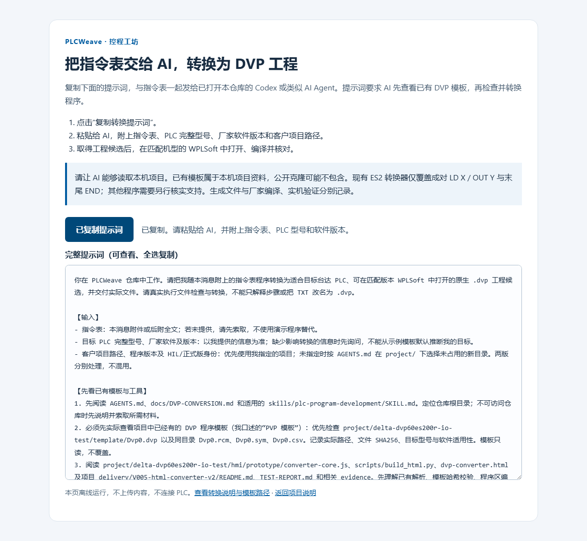
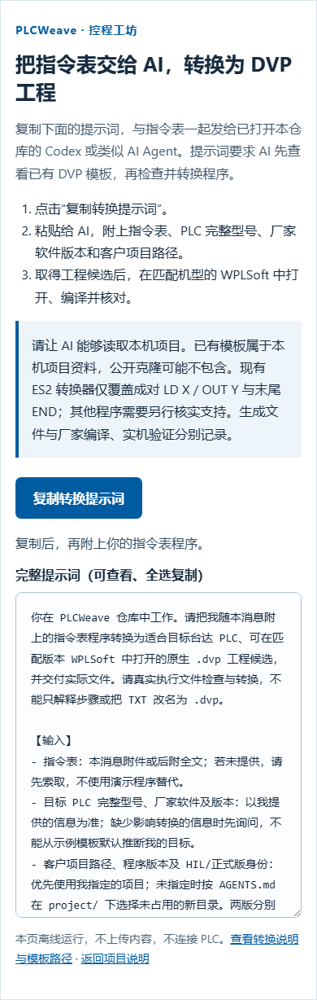

# DVP 转换提示词页

入口：根目录 README 中的“指令表转台达 DVP” → [本地离线页面](../../prototype/dvp-prompt.html)。

组件：使用步骤、支持范围提示、“复制转换提示词”按钮、只读全文、复制状态、说明链接。数据绑定见 [参数表](../../params.md) 的 DVP 提示词页补充；无设备地址。

点击按钮优先使用浏览器剪贴板接口，拒绝或不可用时尝试选区复制；两者失败则选中全文并提示 Ctrl+C / ⌘C。成功后显示“已复制提示词”和附加指令表、机型、软件版本的提醒。用户再把提示词与自己的程序交给可访问仓库的 AI；页面本身不进行程序转换。

状态变体：初始、复制成功、自动复制失败后手动复制；窄屏按钮与状态纵向排列，全文框可纵向调整。本页无需端口，无联网资源，未读取或操作 PLC。

2026-11-06 核验：本地 Chromium 实际点击并读回系统剪贴板，按 Windows CRLF/LF 换行归一后与源提示词一致；另用受控浏览器接口覆盖剪贴板拒绝、接口缺失、选区复制失败后的手动复制提示。1200px 桌面与 390px 窄屏截图已更新，窄屏无横向溢出，页面链接存在且无脚本错误。此次仅验证文档与复制页面，未转换客户程序或执行厂家编译、硬件测试。
